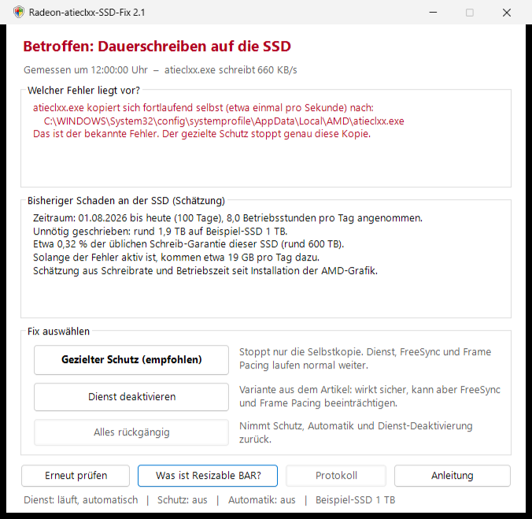
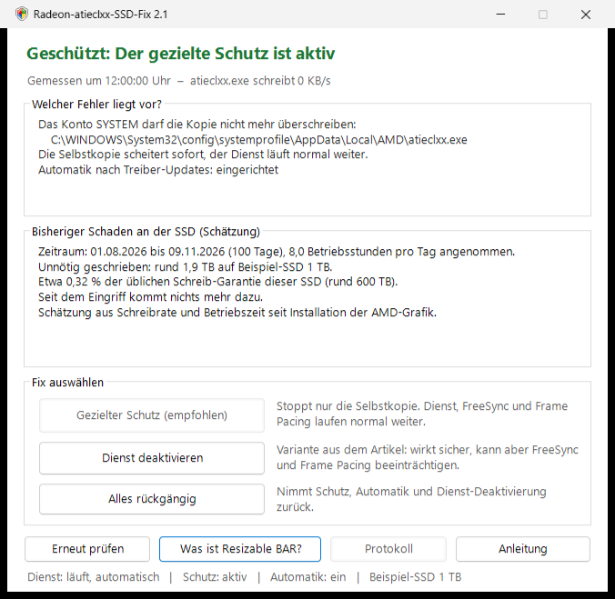

# Radeon-atieclxx-SSD-Fix

**Is the Radeon driver constantly writing to your SSD?** With affected drivers, `atieclxx.exe` (the "AMD External Events Utility" service) copies itself every second – about 56 GB per day. This program checks whether your PC is affected, estimates the damage so far and stops the continuous writing in a targeted way, without turning the service off.

> **Note:** Unofficial workaround, not from AMD and not affiliated with AMD. Use at your own risk, without warranty and without liability (see [LICENSE.txt](LICENSE.txt)).



*Example view, all values are examples. The screenshots were taken with the original German interface; the program itself is now in English.*

## The problem

On 2026-11-09 ComputerBase reported that the "AMD External Events Utility" service of the Radeon driver continuously writes to the system drive for many users ([article](https://www.computerbase.de/news/grafikkarten/schnelle-ssd-alterung-radeon-treiber-schreibt-fortwaehrend-daten-auf-die-ssd.100237/), in German). AMD has confirmed the bug; there is no fixed driver version yet.

Measured with Event Tracing for Windows (ETW): with affected drivers, `atieclxx.exe` **copies itself every second** from the driver folder to

```
C:\Windows\System32\config\systemprofile\AppData\Local\AMD\atieclxx.exe
```

The file is about 660 KB, which adds up to roughly 56 GB per day of continuous operation. Afterwards the service looks for installation files of the filter driver `amdkmpfd` (Smart Access Memory). That explains why turning off Resizable BAR helps some people.

## Download and start

1. Download `Radeon-atieclxx-SSD-Fix.zip` from [**Releases**](../../releases/latest).
2. Extract the ZIP file completely.
3. Double-click `START.cmd` and confirm the Windows prompt for administrator rights with "Yes".

If Windows warns ("Windows protected your PC"): "More info" → "Run anyway". Or unblock the ZIP file before extracting it: right-click → Properties → "Unblock".

## What the program does

- **Analysis:** measures whether and how much `atieclxx.exe` writes, and shows which variant is present: self-copy to the known location, writing elsewhere, or not affected.
- **Damage estimate:** how much has already been written to the SSD unnecessarily (write rate × operating time since the AMD graphics device was installed) and what share of the usual write endurance rating that is.
- **Fix buttons:**

| Button | Effect |
|---|---|
| **Targeted protection** (recommended) | Denies only the SYSTEM account permission to overwrite this one copy. The copy attempt fails immediately and nothing is written any more. Service, FreeSync, Frame Pacing and hotkeys stay untouched. Also sets up a guard task (see below). |
| **Disable service** | The variant from the article. Always works, but may impair FreeSync and Frame Pacing. |
| **Revert everything** | Reverts the protection, the guard task and the service disabling. |

The third option from the article, turning off Resizable BAR in the BIOS, is explained by the program. It can only be done in the BIOS.



*State after the targeted protection, also with example values.*

### Guard task for driver updates

The targeted protection sets up the task "Radeon-atieclxx-SSD-Fix" in the Task Scheduler. It runs as SYSTEM 3 minutes after startup and every 30 minutes, and

- sets the protection again if a driver update has replaced the file,
- checks by itself after a driver change whether AMD has fixed the bug, and then lifts the protection on its own,
- writes to the log `C:\Program Files\Radeon-atieclxx-SSD-Fix\log.txt` only when something happens.

## Technical details

- Protection: `icacls <copy> /deny *S-1-5-18:(WD,AD,WEA,WA,DE)`, i.e. a deny entry for the SYSTEM account only, on exactly this one file.
- The self-copy is detected through the USN of the NTFS change journal (`FSCTL_READ_FILE_USN_DATA`). Timestamps are no use here because `CopyFile` takes them over from the source. As a fallback, a short ETW trace (at most 64 MB, deleted immediately) finds out where the writes go.
- The measurement runs in the background, so the window stays usable.
- No downloads, no internet connection, no change to the driver, no AMD files in the package. The complete source code is in the [`Script`](Script) folder.

## Check status and remove

| File | Purpose |
|---|---|
| `CHECK.cmd` | status and 10-second measurement, no administrator rights needed |
| `REMOVE.cmd` | reverts everything and deletes the program folder |

After the targeted protection both are also found in `C:\Program Files\Radeon-atieclxx-SSD-Fix`.

## Alternative without this program

`Win+R` → `services.msc` → "AMD External Events Utility" → Stop, startup type "Disabled". This is the suggestion from the article; it may impair FreeSync and Frame Pacing.

## Limitations

- Other driver versions may behave differently. The program therefore measures first and only intervenes if the fix works.
- The damage estimate is an estimate. Many SSDs do not pass their operating hours on to Windows; in that case 8 hours per day are assumed.
- On PCs where company policy only allows signed PowerShell scripts, the program does not start.
- On Windows Home the task cannot show pop-up notices (`msg.exe` is missing there). Everything is still recorded in the log.

## License and trademarks

MIT license, see [LICENSE.txt](LICENSE.txt). AMD, Radeon and Smart Access Memory are trademarks of Advanced Micro Devices, Inc. This project is not affiliated with AMD and is neither supported nor reviewed by AMD.
